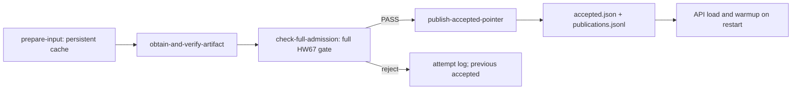

# ДЗ 8+9+10: выпуск модели, проверки и API

Исправлены семь независимых причин в прототипе. Реальный Prefect управляет
подготовкой, проверкой артефакта, полным допуском и публикацией; FastAPI
загружает принятую модель и сообщает её фактическую идентичность.
Кандидат ДЗ67 честно отклонён, сервис обслуживает начальную baseline.
Обучение, повторный sweep и ослабление gate не выполнялись.

## Версии и воспроизведение

Репозиторий: https://github.com/IvanKaruzin/MLOps.
Исходный неизменённый прототип: `5b8efbc35db98f707204ff0d15c7f8f0d0fab3ac`.
Исправленный коммит определяется `git log -1 --format=%H -- release.py`;
точные SHA исходников каждого опыта записаны в его JSON-доказательстве.
Исходник можно получить через `git archive 5b8efbc hw8910-broken`.
После переноса рабочая папка прототипа удалена.

Машина: MacBook Pro, Apple M4 Pro, 48 ГБ, macOS 26.6.2 arm64;
Python 3.12.13, MPS, bfloat16. Основное окружение из исходного `uv.lock`:
Torch 2.14.0, Transformers 5.16.1, PEFT 0.20.0, MLflow 2.22.2,
FastAPI 0.162.0, Uvicorn 0.54.0, Pydantic 2.13.5.
Отдельная `.venv-prefect`: Prefect 3.8.8, FastAPI 0.139.0,
Uvicorn 0.54.0, Pydantic 2.13.5; все транзитивные версии и хеши
в `requirements-hw8910.lock`. Prefect использует удалённый в FastAPI 0.162
аргумент `Body(min_items=...)`, поэтому API Prefect отделён от модели.
Пакеты не патчились. Проверяющий subprocess использует исходную `.venv`.

```bash
make install-hw8910
make check-hw8910
make check-all
.venv/bin/python -B scripts/check_hw8910_regressions.py --out docs/hw8910/evidence
.venv-prefect/bin/python -B scripts/prove_hw8910_process.py --out docs/hw8910/evidence
make prepare-hw8910
make flow-hw8910   # ожидаемый отказ и exit 1
make serve-hw8910
# После /ready 200, в другом терминале:
.venv/bin/python -B scripts/benchmark_hw8910.py
# Остановить предыдущий API; этот скрипт сам управляет двумя серверами:
.venv/bin/python -B scripts/smoke_hw8910.py
```

Для сохранённого Colima-профиля нужны `colima start --profile mlops-hw67`
и `DOCKER_CONTEXT=colima-mlops-hw67 make up`. Обычный Docker использует
`make up`. Действующие volumes не удалять. Перед реальными опытами MLflow
должен отвечать на `http://127.0.0.1:5006/health`.

## Семь причин и тестовые доказательства

Полная цепочка симптом → воспроизведение → фактический/ожидаемый результат
→ причина → исправление → тест находится в [defects.csv](defects.csv).

| Причина прототипа | Исправление |
|---|---|
| Кешировал путь вместо данных и config | SHA канонического `{data_sha256, config}` |
| Truthiness `passed` принимала неполный/чужой отчёт | Полная схема, `passed is True`, четыре хеша, model ID, конечные метрики |
| Прямая запись портила указатель при ошибке | Соседний tempfile, flush/fsync, атомарный replace, cleanup |
| Безусловный append размножал публикации | Устойчивая release identity и восстанавливаемый intent |
| Готовность устанавливалась до прогрева | Ready только после загрузки и вызова warmup |
| Metadata читалась из нового pointer при старом backend | Неизменный снимок фактически загруженного backend |
| Backend вызывался до валидации запроса | Строгая валидация до вычисления, счётчики в тестах |

Исходные 13 тестов побайтно сохранены. Одинаковые 7 собственных интеграционных
тестов запускаются с настоящими FS/HTTP/subprocess на обеих версиях:
на исходнике все 7 содержательно FAIL, без import/CLI/infrastructure errors;
на исправленном коде 13+7 PASS. Три теста используют настоящий HTTP-сервер,
несколько запусков выпуска выполняются из отдельных cwd/workspace.
Подробности, точные хеши и diff:
[regressions.json](evidence/regressions.json), `seed-*.log`, `fixed-*.log`,
[fixes.patch](evidence/fixes.patch).

Общий `make check-hw8910`: **46/46 PASS**, без загрузки весов, MLflow или
Prefect-сервера ([лог](evidence/fast-tests.log)). Помимо 13+7 есть
8 тестов HTTP-контракта, 12 проверок runtime/evidence и 6 проверок целостности
процесса. Отдельно во временную копию текущего кода внесена поломка:
cache_key игнорирует байты входа. Исходные 13 тестов дают 1 FAIL, exit 1;
после восстановления той же копии 13 PASS, exit 0. Хеши исходников проекта
не изменились, копия удалена: [intentional-check.json](evidence/intentional-check.json),
[красный лог](evidence/intentional-red.log), [восстановленный](evidence/restored-green.log).

Исходный `make check-all` сохраняет область ДЗ67: **9/9 MLflow + 56 eval +
5 pipeline PASS**, отпечаток `tests/` — `668541c5fccd`.
[Лог](evidence/hw67-check-all.log). Проверки ДЗ1–5 не добавлялись.
Локальные проверки выполнены; удалённый CI и защита merge не заявляются.

## Prefect, кеш и восстановление



Веса не передаются между задачами: только пути, URI, ID и хеши.
Получение артефакта читает готовый training run ДЗ67 и проверяет файлы.
Обучения на этой стадии нет. Подготовка выполняет проверку UTF-8 и лексическую
сводку строк с max_length; это не HF-токенизация. В реальном workspace вход —
4800 строк training-index; `format=jsonl` проверяет уникальные ID и непустые input.

Ключ включает байты входа и все поля config: точную ревизию токенизатора,
его SHA, SHA шаблона, max_length и совместный SHA файлов `lab.py`/`release.py`.
Результат хранится
в `workspace/cache` и в persisted results Prefect. После завершения процесса
новый процесс получает `Cached`. Только подготовка кешируется; получение,
допуск и публикация имеют `NO_CACHE`, чтобы не переиспользовать старый PASS.

[process-summary.json](evidence/process-summary.json),
[полный лог](evidence/process-runs.log) и
[12 запусков](evidence/process-runs.jsonl) содержат точные команды,
cwd, exit codes, flow run IDs, состояния задач и SHA pointer до/после.
Опыт создаёт один временный Prefect-сервер, после завершения останавливает его.

| Опыт | Exit | Подготовка | Число публикаций |
|---|---:|---|---:|
| Сбой после подготовки | 1 | Completed | 0 |
| Новый процесс без сбоя | 0 | Cached | 1 |
| Повтор того же выпуска | 0 | Cached | 1 |
| Новые bytes по прежнему пути | 0 | Completed | 1 |
| Изменение config | 0 | Completed | 1 |
| Новый evaluation ID | 0 | Cached | 2 |
| Отклонённый отчёт | 1 | Cached | 2 |
| Отдельный workspace: сбой pointer→journal | 1 | Cached | 0 |
| Восстановление pointer/journal | 0 | Cached | 1 |
| Повтор восстановленного выпуска | 0 | Cached | 1 |

В отдельном recovery-workspace локальных cache-файлов может быть ноль:
Prefect читает общий persisted result по тому же content/config ключу.
Это видно в состояниях задач и не выдаётся за повторное исполнение подготовки.

Один писатель. Release ID — SHA канонических manifest + связанного admission.
Попытки хранятся отдельно в `attempts.jsonl`, события — в `publications.jsonl`.
Перед заменой pointer сохраняется проверенный `publication-intent.json`.
Повтор проверяет intent, завершает pointer/journal и удаляет intent;
одинаковый ID не добавляется дважды. Intent — механизм восстановления,
атомарная замена сама по себе не является транзакцией двух файлов.
Ошибки схемы/качества не ретраятся. Веса повторно проверяются перед выпуском
и загрузкой. Ошибка replace и отказ сохраняют прежние байты указателя.

## Реальная модель, gate и происхождение

| Сущность | Зафиксированное значение |
|---|---|
| Исходный sweep parent | `c91104948b3c41e3abbd54a07bcb71c7` |
| Training run кандидата | `724f89d55d204ee1a24b6373fb6539dd` |
| Registry candidate | `models:/my-qwen-adapter/5` |
| Baseline/candidate evaluation run | `ef925fe3d3cc4a5f881beea453e3a463` |
| Реально загруженная baseline | `Qwen/Qwen3-0.6B@c1899de289a04d12100db370d81485cdf75e47ca` |
| Generation | тот же system, greedy, seed 20261025, thinking=false, max_new_tokens=96 |

[release-report.json](release-report.json) создан обвязкой после повторной
проверки сохранённых raw, полного scorer и `quality_gate` ДЗ67.
Accuracy/format rate, критические срезы и behavioral сохранены.
Кандидат: accuracy 3/90, format 75/90, behavioral 0/5; gate **false**.
Отчёт содержит пути и файловые SHA исходных полных eval и raw;
`metrics/*-eval.json`, `*-outputs.json`, `evaluation/params.json` остаются исходными.
Вычисление допуска не генерирует новые ответы и не меняет пороги.
`val_loss`, строка `"true"`, fixture PASS, чужой report, NaN/Inf,
неполнота, stale runtime и подменённые файлы не разрешают выпуск.

Сохранены [manifest кандидата](manifest-candidate.json),
[manifest baseline](manifest-baseline.json) и
[явное основание bootstrap](baseline-bootstrap.json).
Хеш модели — SHA канонического словаря `relative path → actual file SHA`;
для адаптера включены веса и adapter_config, отдельно закреплены base assets.
Runtime связывает точную базу, токенизатор, chat template, system/seed/greedy/
thinking/max_new_tokens, dtype и device. Криптографическая аутентичность
upstream HF snapshot опирается на доверенный HF cache и закреплённую revision;
manifest обнаруживает последующие изменения файлов, а не подмену всего
доверенного cache вместе с пересозданием manifest.

Настоящий Prefect-отказ: [лог](evidence/real-candidate-rejection.log),
[сводка](evidence/real-candidate-rejection.json), flow run
`ac3e38cc-b33c-49c3-a9d1-8b4ba441f30c`, exit 1;
prepare/artifact Completed, admission Failed, публикация не запускалась.
SHA accepted до и после одинаков:
`75fc86f5a08b26d9834890d83b5af4561610a9176d3447b19b545915f2851211`.
Начальная baseline выбрана явно по разрешённому условиями сценарию;
её bootstrap не является candidate PASS или назначением MLflow champion.
Синтетический успешный Prefect-проход доказывает управление выпуском,
а не качество модели.

## API и смена версии

FastAPI запускает загрузку в lifespan: `/health` подтверждает жизнь процесса,
`/ready` и генерация дают 503 до загрузки и прогрева.
Далее `/ready` сообщает фактически загруженные ID и runtime SHA.
Один lock допускает одно вычисление одновременно; вход ограничен 4096 символами,
реальная модель — 512 входными токенами, тело запроса — 64 КиБ.
Лимит ответа строго 96 токенов; bool/string/null и иные параметры отклоняются.
Неправильный запрос не вызывает генерацию; это проверяется счётчиками stub.
Ответ содержит answer, request_id, model_id, runtime_sha256, output_tokens,
время очереди, генерации и total. Реальный backend работает в eval/inference_mode.

STUB-опыт в `test_http_loaded_version_changes_only_after_restart_and_supports_rollback`:
загрузить A → выпустить B → до restart ответ/ID A → restart ответ/ID B →
валидированно выпустить прежнюю A → restart ответ/ID A. Используются реальные
HTTP и процессы, ответы явно `STUB ONLY`. Это контрольный опыт, не новая модель.

[Реальный smoke](smoke.json) отдельно дважды загрузил baseline из accepted:
в обоих процессах ready 503→200, health 200, generate 200,
некорректный лимит 422, `/debug` 404. Оба сервера завершены с exit 0.
Ответ `{"answer": "драма, история, фэнтези"}`, 17 выходных токенов,
совпадает с прежним raw для movie-free-001; это доказательство инференса,
а не верности классификации. SHA runtime:
`1b23d07654b3cc6b742c72e0568b88fab94482ad01e1ad447600fb7cf4ac750c`.
Автоматической перезагрузки по изменению pointer нет. Второго реально
допущенного адаптера сейчас нет; текущий real loader намеренно принимает
только эту baseline. Перед будущим выпуском адаптера требуется добавить
его загрузку через PEFT, проверить интерфейс и выполнить полный допуск;
одной ручной правки manifest недостаточно.

## Замер 8+8

После прогрева один набор movie-free-001…008, одинаковые system/runtime и
лимит 96. Все 16 попыток сохранены в [requests.jsonl](requests.jsonl),
сводка — [benchmark.json](benchmark.json). Ошибки не отфильтровываются.
Все 8 последовательных raw совпали с сохранённой baseline ДЗ67.

| Concurrency | n | Успех / ошибка | Пакет, с | Успешных req/s | Средняя / max latency, с | Средняя очередь, с | Средняя генерация, с | Токены |
|---:|---:|---:|---:|---:|---:|---:|---:|---:|
| 1 | 8 | 8 / 0 | 3.3741 | 2.3710 | 0.4217 / 0.6455 | 0.000001 | 0.4206 | 167 |
| 2 | 8 | 8 / 0 | 3.2410 | 2.4684 | 0.7772 / 1.1152 | 0.3706 | 0.4049 | 167 |

Средняя/max latency ошибок в обоих режимах — null: ошибок не было.
Параллельные клиенты ждут один generation lock, поэтому их задержка растёт
из-за очереди. Различие req/s на восьми запросах не доказывает устойчивый
прирост производительности. Измерена полная задержка JSON-ответа, не TTFT/ITL;
достоверный p95 и отдельные фазы prefill/decode здесь не измерялись.

Prefill обрабатывает prompt и строит начальный KV-cache; decode добавляет
токены последовательно, переиспользуя ключи/значения внимания.
KV-cache растёт с длиной контекста, числом одновременных последовательностей,
слоёв, KV-heads, размером head и байтами dtype. Один последовательный
Transformers backend без batching не доказывает скорость SGLang/vLLM.

## Триггеры и доступ к артефактам

| Событие | Конкретные действия |
|---|---|
| Новый код | `make check-hw8910`; при изменении генерации также `make evaluate && make eval`, затем `make prepare-hw8910` и smoke. Документация не требует обучения. |
| Данные | Для preparation изменить input/config и запустить `flow.py`: content key инвалидируется. При изменении golden/behavioral: `make prepare-eval`, `make check-eval`, `make evaluate`, `make eval`. Изменение train требует решения о новом обучении, а не автоматического запуска в release flow. |
| Новый адаптер | Проверить загрузчик, `make candidate`, полный `make evaluate`, `make eval`, `make prepare-hw8910`, `make flow-hw8910`; публикация только после PASS, затем restart и smoke. Текущий baseline-only loader предварительно расширить и проверить. |

Golden, behavioral и training-index восстанавливаются из
`docs/datasets/hw67-evaluation.tar.gz`; источник и тензоры — по инструкциям
DVC в README. Base snapshot доступен публично:
https://huggingface.co/Qwen/Qwen3-0.6B/tree/c1899de289a04d12100db370d81485cdf75e47ca.
Для пустого HF cache один раз выполнить:

```bash
.venv/bin/python -c 'from huggingface_hub import snapshot_download; snapshot_download("Qwen/Qwen3-0.6B", revision="c1899de289a04d12100db370d81485cdf75e47ca")'
tar -xzf docs/datasets/hw67-evaluation.tar.gz
```

MLflow хранит адаптер и исходный model package в существующих Docker volumes.
На машине сдачи открыть `http://127.0.0.1:5006`, training run из таблицы,
Artifacts → model. Для переноса преподавателю нужен этот model package
и сохранённые MLflow/Postgres volumes, либо доступ к работающему локальному
стенду; Git-клон сам по себе не содержит приватный локальный адаптер.
Команда `make prepare-hw8910` скачивает его из MLflow и проверяет происхождение;
Манифесты в docs фиксируют измеренный локальный путь, в другом клоне
они заново создаются командой prepare, вручную их не редактируют.
Веса, `.venv`, runtime workspace, кеши и volumes исключены из Git.
При остановленном Colima сначала восстановить профиль и `make up` —
ошибку доступности нельзя считать отказом модели по качеству.

Скринкаст и сценарий не создавались по прямому указанию пользователя.
